  

# Awesome Multi-Tenant Cloud Architecture

> A curated list of top Multi-Tenant Cloud Architecture platforms — both SaaS/Hosted commercial solutions and open-source alternatives for building, operating, and governing multi-tenant SaaS applications at scale.
> 🌟 Star this repo if you find it useful! 🌟

---

## 📋 Table of Contents

- [SaaS / Hosted Platforms](#-saas--hosted-platforms)
  - [Druva Multi-Tenant Cloud](#druva-multi-tenant-cloud)
  - [Auth0 Organizations](#auth0-organizations)
  - [Snowflake Multi-Cluster Shared Data](#snowflake-multi-cluster-shared-data)
  - [Datadog Multi-Organization](#datadog-multi-organization)
  - [ServiceNow Multi-Instance Cloud](#servicenow-multi-instance-cloud)
  - [Cloudflare Workers for Platforms](#cloudflare-workers-for-platforms)
  - [Kong Konnect Multi-Tenancy](#kong-konnect-multi-tenancy)
- [Open-Source Software](#-open-source-software)
  - [AWS SaaS Boost](#aws-saas-boost)
  - [Moneygun](#moneygun)

---

## 🟦 SaaS / Hosted Platforms

Commercial, cloud-hosted Multi-Tenant Cloud Architecture platforms. These are not open-source but are included as reference points for feature comparison.

### Druva Multi-Tenant Cloud
**Type:** SaaS data protection on a global multi-tenant microservices platform
Druva's cloud platform is architected as a **global, multi-tenant cloud microservices platform built on AWS**, with Druva responsible for the overall availability, security, and continuous maintenance of the platform itself [citation:1]. The architecture handles auto-scaling of backend computing resources, auto-scaling backend storage, and geo-redundant storage options to meet regional SLAs [citation:1]. Tenant isolation is enforced through the shared responsibility model, with Druva managing the multi-tenant infrastructure and customers managing their endpoint configurations. **Best for:** Organizations wanting a fully managed SaaS data protection platform where multi-tenancy is handled entirely by the vendor.

### Auth0 Organizations
**Type:** Identity-layer multi-tenancy for B2B SaaS
Auth0 Organizations is the recommended approach for implementing multi-tenancy in B2B SaaS applications, representing a tenant (company, workspace, or customer account) as an isolated unit within Auth0 [citation:3][citation:13]. Each Organization has its own members, connections (identity providers), metadata, and roles/permissions scoped exclusively to Organization membership [citation:13]. Key capabilities include **Home Realm Discovery** (automatically routing users to their enterprise IdP based on email domain), self-service and enterprise onboarding in one codebase, and the `organization` parameter on authorization requests that scopes the entire login experience [citation:13]. **Legacy alternatives** include representing tenants as separate connections, applications, or Auth0 tenants—each with trade-offs around entity limits and configuration overhead [citation:3]. **Best for:** B2B SaaS teams wanting to outsource the identity and access management layer of multi-tenancy while maintaining per-tenant isolation.

### Snowflake Multi-Cluster Shared Data
**Type:** Data platform with multi-cluster shared data architecture
Snowflake's architecture separates storage, compute, and cloud services into three independent layers, enabling **multi-cluster shared data** where multiple compute clusters access a single shared data store [citation:5]. The **data storage layer** uses cloud object storage (AWS S3, Azure Blob, GCP) with columnar file format, while the **virtual warehouse layer** provides independent compute clusters that scale up/down on demand, and the **cloud services layer** handles authentication, metadata, query optimization, and access control [citation:5]. This architecture enables **multi-tenant data sharing** where consumers access live, read-only data without copying, and providers maintain control over governed subsets [citation:15]. **Best for:** Analytics platforms needing workload isolation and elastic scaling across tenants without data duplication.

### Datadog Multi-Organization
**Type:** Observability with parent-child organization isolation
Datadog's multi-organization feature provides **logical groups of users, configurations, and telemetry data** with a parent-child relationship, allowing large enterprises to isolate divisions while consolidating billing and contract data in the parent organization [citation:6]. Configurations can vary among child organizations or be centrally governed, and users can belong to multiple child organizations and switch between them [citation:6]. Recommended structural models include stage-dependent (pre-production vs. production), multi-division (per legal entity), and data-sensitivity (per classification level) [citation:6]. **Best for:** Enterprises needing compliance-driven isolation between divisions while maintaining centralized observability governance.

### ServiceNow Multi-Instance Cloud
**Type:** Multi-instance architecture with per-customer isolation
ServiceNow uses a **multi-instance architecture** where each customer runs on separate application nodes and database processes, ensuring that one customer's data is processed separately from others and that maintenance on one instance does not impact any other . Customers can upgrade on their own schedule without downtime, and each instance is supported by multi-homed network configurations with redundant power and multiple internet paths . The Advanced High Availability (AHA) architecture pairs colocation facilities with asynchronous replication, maintaining a main-main relationship where each facility can support the combined production load of both . **Best for:** Enterprises requiring strict data sovereignty, independent upgrade cycles, and maximum availability isolation per customer.

### Cloudflare Workers for Platforms
**Type:** Isolated compute sandboxes for multi-tenant platforms
Cloudflare Workers for Platforms lets you run **untrusted code written by your customers (or AI) in secure, isolated sandboxes**, with each customer running code in their own Worker [citation:8]. The architecture uses **dispatch namespaces** and a **dynamic dispatch Worker** to route requests to the correct user Worker, with outbound Workers for egress control. Features include per-customer limits on CPU time and subrequests, observability with export to Datadog/Splunk/Grafana, and tags for organizing Workers by customer ID or plan type [citation:8]. **Best for:** Platforms that need to execute tenant-provided code (extensions, plugins, automations) with strong isolation guarantees.

### Kong Konnect Multi-Tenancy
**Type:** Control-plane isolation for AI Gateway and Kong Gateway
Kong Konnect's AI Gateway supports **multiple instances per organization**, where each instance operates independently with isolated entities (AI Models, Providers, Policies), separate telemetry endpoints, and data plane pools that register under a single instance only [citation:9]. This provides per-team, per-environment, or per-region isolation. AI Gateway instances are **top-level resources distinct from Kong Gateway control planes**, sharing no entities, credentials, or plugins, and cannot share a Konnect Workspace [citation:9]. **Best for:** Organizations wanting control-plane-level isolation for AI/LLM gateway workloads without infrastructure duplication.

---

## 🟩 Open-Source Software

Self-hosted, community-driven Multi-Tenant Cloud Architecture tools. The open-source ecosystem spans **AWS-native SaaS toolkits** and **framework-level multi-tenancy boilerplates**.

### AWS SaaS Boost
**Stack:** Java / AWS CDK / CloudFormation / ECS / Lambda | **License:** Apache-2.0
AWS SaaS Boost is an **open-source, ready-to-use reference environment** that accelerates migrating applications to a SaaS delivery model on AWS, based on best practices from hundreds of successful SaaS companies [citation:2][citation:12]. Key out-of-the-box capabilities include:
- **Tenant management** with onboarding service orchestrating tenant creation, infrastructure provisioning, workload deployment, and billing setup [citation:2]
- **Deployment automation** via CloudFormation macros that dynamically create resources for application services per tenant [citation:2]
- **Analytics dashboards** with optional metrics-analytics module writing to Redshift [citation:2]
- **Billing and metering** module for usage-based monetization [citation:2]
- **Admin web application** for centralized management [citation:2]

The architecture uses per-tenant ECS services, VPC CIDR allocation via DynamoDB, and CodePipeline for workload deployment. Customers like MAGIQ Software report migrating in **months rather than years** and reducing deployment/operational costs [citation:12]. **Trade-off:** It is a reference environment rather than a turnkey product—teams must adapt it to their application, and it is AWS-specific.
**Best for:** ISVs and software teams wanting a proven, AWS-native foundation for multi-tenant SaaS with tenant provisioning, billing, and analytics out of the box, accepting the reference-implementation adaptation effort.

### Moneygun
**Stack:** Ruby on Rails 8 / PostgreSQL / Stripe (Pay gem) / Devise | **License:** MIT
Moneygun is a **Rails 8 SaaS multi-tenancy boilerplate** using a row-based, route-based tenancy model where users belong to Organizations through Memberships . Key features include:
- **Multi-tenant architecture**: route-based organization management (e.g., `acme.yourapp.com`)
- **Team management**: invitations, roles, member administration
- **Stripe subscriptions** via the Pay gem, ready to monetize
- **Authentication**: Devise + OAuth (Google, GitHub)
- **Authorization**: Pundit policies scoped per organization
- **Modern UI**: Tailwind CSS, daisyUI, dark mode
- **Feature flags**: Flipper
- **Background jobs**: GoodJob
- **Admin panel**: Avo
- **User impersonation**: Masquerade

The project is explicitly positioned as a **free, simple foundation you fully own and understand**—no framework abstractions, no subscription, just plain Rails . It is compared against Bullet Train (more full-featured, team-based tenancy) and Jumpstart Pro (commercial, multiple tenancy strategies) . **Trade-off:** It is a lightweight starting point rather than a production-grade framework—teams needing advanced features like audit logs, REST APIs, or mobile apps should evaluate Bullet Train.
**Best for:** Rails developers building B2B SaaS wanting a free, readable, MIT-licensed boilerplate with row-based multi-tenancy and Stripe subscriptions, accepting a minimal feature set.

---

## 📊 Comparison at a Glance

| Software | License | Stack | Tenancy Model | Isolation Level | Self-Hosted | Best For |
|----------|---------|-------|---------------|-----------------|-------------|----------|
| **Druva** | Proprietary | Cloud (AWS) | Shared microservices | Logical | ❌ | Managed data protection SaaS |
| **Auth0 Organizations** | Proprietary | Cloud | Per-Organization | Logical + IdP | ❌ | B2B SaaS identity multi-tenancy |
| **Snowflake** | Proprietary | Cloud | Multi-cluster shared data | Compute + data | ❌ | Analytics workload isolation |
| **Datadog Multi-Org** | Proprietary | Cloud | Parent-child orgs | Logical + telemetry | ❌ | Enterprise observability isolation |
| **ServiceNow** | Proprietary | Cloud | Multi-instance | Instance-level | ❌ | Strict data sovereignty |
| **Cloudflare Workers** | Proprietary | Cloud | Dispatch namespaces | Compute sandbox | ❌ | Untrusted tenant code execution |
| **Kong Konnect** | Proprietary | Cloud | Per-instance | Control-plane | ❌ | AI Gateway isolation |
| **AWS SaaS Boost** | Apache-2.0 | AWS (Java) | Per-tenant ECS | Infrastructure | ✅ (AWS) | ISV SaaS migration foundation |
| **Moneygun** | MIT | Rails 8 | Row-based (route) | Logical (row) | ✅ | Rails B2B SaaS boilerplate |

---

## 🤝 Contributing

Contributions are welcome! If you know of an open-source Multi-Tenant Cloud Architecture tool that should be listed here, please open a pull request with:

- Project name and URL
- Brief description (1–2 sentences)
- Stack and license
- Why it stands out

Please ensure the project is actively maintained (releases within the last 12 months) and genuinely open-source.

**Note on the open-source ecosystem:** The multi-tenant architecture space is **dominated by commercial platforms** because multi-tenancy is an architectural pattern applied within a platform rather than a standalone product. **AWS SaaS Boost** is the most comprehensive open-source option, providing a full reference environment with tenant provisioning, billing, and analytics—but it is AWS-specific and requires adaptation [citation:2][citation:12]. **Moneygun** is a notably different approach: a lightweight Rails boilerplate for row-based tenancy, MIT-licensed and fully readable, positioned as a foundation rather than a framework . For teams needing a production-grade Rails framework, **Bullet Train** (MIT, team-based tenancy, official support) is the more full-featured open-source alternative referenced in Moneygun's own comparison . No open-source project replicates the full breadth of ServiceNow's multi-instance isolation or Snowflake's multi-cluster architecture—those remain commercial differentiators.

---

## 📄 License

This list is released under CC0 1.0 Universal (Public Domain). The software projects listed retain their respective licenses.

---

⭐ **If this list helped you discover a useful tool, please star the repo!** ⭐
